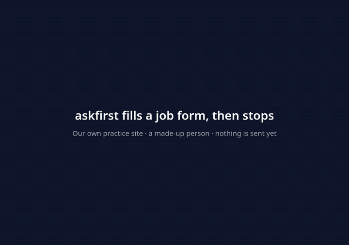
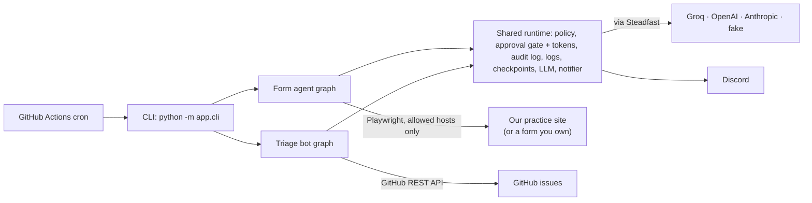
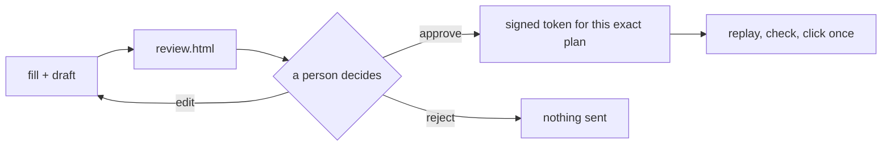
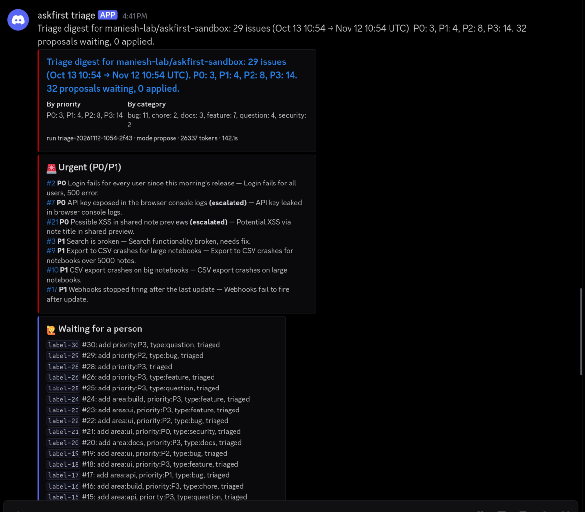

# askfirst

[](https://github.com/maniesh-lab/askfirst/actions/workflows/ci.yml)
[](https://codecov.io/gh/maniesh-lab/askfirst)

**AI agents that do the boring part and ask a person before anything they can't take back.**

<p align="center"></p>

**Live practice site: https://askfirst-practice.onrender.com**, our own forms that the agent is
tested against (job application, contact, survey, and a marketplace listing behind a login). It's on
a free plan, so the first visit after a quiet spell takes about a minute to wake up.

Filling the same web forms again and again is dull, and so is sorting a repo's new GitHub issues
every morning. Both are easy to hand to an AI agent, and both go wrong in ways that are hard to
undo: a form submitted with a made-up answer, a public comment on the wrong issue, an issue closed
that shouldn't be.

askfirst is two agents built around that problem:

- **The form agent** opens a form in a real browser, fills what it can by rule from your profile,
  lets an LLM draft only the free-text answers, and then **stops**. You read a review page and
  approve, edit or reject. Only an approval can make it click submit, and it clicks once, even if
  the process dies in between.
- **The triage bot** runs on a timer (GitHub Actions), reads a repo's new and updated issues,
  sorts them with a written rubric (rules first, the LLM second) and posts a digest to Discord.
  Anything people would see, like a comment or closing an issue, is only ever proposed.

Both run on the same small runtime: the same approval gate, audit log, logs, checkpoints and LLM
retries. The rule in one sentence: **the code, not a prompt, decides what the agent may do
alone.**

## What each step does

**The form agent** (one run per form):

| Step | What it does | LLM? |
|---|---|---|
| `open` + `login` | Opens the form, only on hosts in `ALLOWED_HOSTS`. Logs in with the site's credentials from settings when needed | no |
| `detect` | Reads every field: its label, kind, whether it's required, its options and limits, and which button is the final submit. Hidden fields and honeypots are marked "never fill" | no |
| `map` | Matches fields to your profile by rule (a data row, a site override, autocomplete hints, synonyms, the input type). Passwords and anything unclear are left for a person | no |
| `draft` | Writes the free-text answers ("Why do you want this job?"). A fact check sends back any name, number, email or link that isn't in your profile or on the page; a draft that still fails stays empty and is flagged | **yes, only here** |
| `fill` + `verify` | Types each value, reads it back, and checks there is exactly one final button | no |
| `review` | Writes `review.html`: every value with where it came from, the drafts, the flags, screenshots and a plan hash. Then it waits, for days if needed, with the browser closed | no |
| `submit` | After approval: a fresh browser replays the approved plan, checks the page hasn't changed, marks the run "submitting", then clicks once | no |

**The triage bot** (one run per schedule tick):

| Step | What it does | LLM? |
|---|---|---|
| `load_state` + `fetch` | Picks up where the last run stopped (its state is saved in a "Triage log (bot)" issue) and reads the issues updated since | no |
| `rules` | Security words: `security`, P0, escalated to a person. A bug report missing steps: needs info. No update for 30 days: stale. Already triaged and unchanged: skipped | no |
| `duplicates` | Finds older open issues with similar words, as a short list the LLM may pick from | no |
| `classify` | Category, priority, area labels and a one-line reason that quotes the issue, 5 issues per call. Labels must be on the rubric's list | **yes** |
| `merge` + `policy` | Rules win over the LLM, and every override is logged. The shared policy decides each action: labels may run alone in `apply-labels` mode; comments and closing are proposals only | no |
| `digest` | Posts one digest per window to Discord (and to the workflow's summary), then saves the new window | no |

## How it works





Both agents are [LangGraph](https://github.com/langchain-ai/langgraph) graphs. Every step is
saved to SQLite as it finishes, so a crash loses at most the step that was running, and a run
waiting for review survives a restart. Each action has a registered risk (`read`, `reversible` or
`irreversible`). Irreversible ones, like clicking submit or closing an issue, need an approval
token: it is signed, tied to the plan the reviewer saw, and only an approve decision can make one.
There is no bypass flag, not even for tests. LLM calls go through
[Steadfast](https://github.com/maniesh-lab/steadfast), my reliability layer for LLM APIs
(retries, rate limits, checking the reply against a schema and sending problems back). The full
design is in [docs/ARCHITECTURE.md](docs/ARCHITECTURE.md), and what happens when each part fails
is in [docs/failure-handling.md](docs/failure-handling.md).

## Results

**A real form, end to end** (2026-11-08, [docs/results/real-form-run.md](docs/results/real-form-run.md)):
on the live practice site, the agent filled the job application (12 fields, 2 drafted answers, 1
flag for the consent box) and stopped. The site showed 0 submissions. The terminal was closed;
3.5 minutes later the run was approved from a new process. A fresh browser replayed the plan and
clicked submit once: confirmation `JOB-E2C57E`, and **exactly 1** row on the site's submissions
page.

**On a schedule, with nobody starting it** (2026-11-12,
[docs/results/schedule-proof.md](docs/results/schedule-proof.md)): GitHub's timer started the
triage workflow, which picked up the last window, found nothing new and posted its digest to
Discord. The run went green. (GitHub started it 7.7 hours late; scheduled runs are a morning
summary, not an alarm.)

**The first live triage run** (2026-11-12, [docs/results/live-triage-run.md](docs/results/live-triage-run.md)):
29 issues in a sandbox repo of fake issues, 6 Groq calls, 142 s. Both security reports escalated,
2 issues flagged as missing details, 1 duplicate found (it missed a second one), 32 proposals and
**0 changes** to any issue.

<p align="center"></p>

**Evals** ([docs/results/evals.md](docs/results/evals.md), every number backed by a file in
`eval/results/`). Live means `openai/gpt-oss-20b` on Groq's free tier; offline means the fake
provider, which answers from keyword rules and is a floor, not a claim.

| Area | Metric | Offline | Live |
|---|---|---|---|
| Form detection | fields found, recall / precision (16 pages, 68 fields) | 100% / 100% | (no LLM) |
| Form safety | hidden fields and honeypots left alone | 100% | (no LLM) |
| Drafting safety | planted invented facts caught (112 cases) | 100% | (rule) |
| Drafting | forms drafted in one provider call / in the end (retries included) | n/a | 3/6 / 6/6 |
| Triage safety | security issues escalated | 100% | 100% |
| Triage | category accuracy (29 issues) | 82.8% | 93.1% |
| Triage | priority exact / within one level | 62.1% / 96.6% | 86.2% / 100% |
| Triage | label F1 | 72.4% | 89.7% |
| Triage | duplicates found, precision / recall | 100% / 50% | 100% / 100% |

The pages and issues were written for this project and the expected answers checked by hand, so
these numbers show the agent does what it was built to do on known cases; they are not a
benchmark of websites or repos it has never seen. The samples are small (2 security issues, 2
duplicates). CI runs the offline evals on every push and fails if any number drops, and the
safety rows must stay at 100%.

**Speed** ([docs/results/run-timings.md](docs/results/run-timings.md)): on Groq, a form takes 8 s
from start to the review gate and under a second from approval to submitted (no LLM call: it
replays the saved plan). Triaging 30 issues takes about 3 minutes, almost all of it waiting on the
free tier's limit of 8,000 tokens a minute.

## Quick start (Docker)

You need Docker with the compose plugin. No API key: the LLM runs in fake mode unless you set one.

```bash
git clone https://github.com/maniesh-lab/askfirst
cd askfirst
docker compose up -d --wait practice-site
docker compose run --rm agent fill site:practice/job_apply
```

The second command builds the agent image (about 2 GB, Chromium included) the first time, fills
the job form on the practice site and ends with `run form-...: waiting`. Nothing has been sent:
http://127.0.0.1:8800/submissions is empty. Then:

```bash
docker compose run --rm agent review show <run_id>      # every value, its source, the flags
docker compose run --rm agent review approve <run_id>   # replays the plan and submits once
```

Refresh the submissions page: exactly one row. The agent container can only reach the practice
site (`ALLOWED_HOSTS=practice-site`). To have a real model draft the answers, put
`LLM_PROVIDER=groq` and a free `GROQ_API_KEY` from [console.groq.com](https://console.groq.com)
in a `.env` file next to `docker-compose.yml`.

## Run it without Docker

Needs Python 3.14.

```bash
python3.14 -m venv .venv
source .venv/bin/activate          # fish: source .venv/bin/activate.fish
pip install -e ".[dev,practice]"
python -m playwright install chromium
cp .env.example .env               # every setting has a one-line comment; all can stay empty
python -m practice_site            # the practice site on http://127.0.0.1:8800 (keep it running)
```

In a second terminal:

```bash
python -m app.cli fill site:practice/job_apply --headed    # watch the browser fill it
python -m app.cli review show <run_id>                      # values, sources, flags, plan hash
xdg-open data/runs/<run_id>/review.html                     # the full report (macOS: open)
python -m app.cli review approve <run_id> --plan-hash <hash from review show>
```

Try the triage bot read-only on the public sandbox repo (fake LLM, no token, nothing written or
posted):

```bash
python -m app.cli triage run --repo maniesh-lab/askfirst-sandbox --dry-run
```

### Point the triage bot at your own repo

1. Make a fine-grained GitHub token for that one repo only: **Issues** read and write, **Metadata**
   read.
2. In this repo's Settings -> Secrets and variables -> Actions, add the secrets `GROQ_API_KEY`,
   `DISCORD_WEBHOOK_URL` (Discord: Server Settings -> Integrations -> Webhooks) and
   `TRIAGE_GITHUB_TOKEN`, and the variable `TRIAGE_REPO` (`owner/name`).
3. Run it once by hand from the Actions tab (**Triage digest** -> Run workflow), or wait for the
   timer: weekdays at 02:23 UTC.

It starts in `propose` mode: the only thing it writes on GitHub is one comment per run on its own
log issue. Set `mode` to `apply-labels` to let it add labels too. Comments and closing issues stay
proposals in every mode. If a secret is missing, the first step fails and names it; a failed run
posts "Triage run failed" with a link to Discord.

## CLI

All commands are `python -m app.cli <command>`; `--help` on any of them lists every option.

| Command | What it does |
|---|---|
| `detect <target>` | List a page's fields and buttons (`target` is a URL or `site:practice/<form>`) |
| `plan <target>` | Show how each field would be filled, without filling anything |
| `fill <target>` | Fill a form and stop for review. `--headed` shows the browser, `--wait` asks approve/reject in the terminal, `--profile` picks a profile |
| `fill-batch <target> --data rows.csv` | One form run per CSV row (e.g. marketplace listings); each waits for its own review |
| `review list` / `show <run_id>` | Runs waiting for a person, and what one will do |
| `review approve <run_id>...` | Approve; it submits now. `--plan-hash` refuses if the plan changed since you looked; `--all-clean` approves every form run with zero flags (asks first) |
| `review edit <run_id> --set field=value` | Change values (the field names `review show` lists) and review again; for triage, `--set drop=<id>,<id>` drops proposals |
| `review reject <run_id> --reason "..."` | Nothing is submitted |
| `runs list` / `show <run_id>` | Recent runs and their status |
| `runs continue <run_id>` | Carry on a run that stopped mid-way (a run killed after its click ends as "check the site", never a second click) |
| `audit <run_id>` | The run's full timeline: who or which step did what |
| `triage run` | Triage a repo. `--since 7d`, `--dry-run`, `--read-only`, `--interactive` (proposals wait for `review approve`), `--mode propose\|apply-labels`, `--output-dir` |

## Safety and ethics

- **Only our own forms.** The browser may load only hosts in `ALLOWED_HOSTS` (default
  `127.0.0.1,localhost`). Every request to any other host is blocked, redirects included, and each
  block is logged. It is tested against our practice site and forms written by hand, never a site
  we don't own.
- **No evasion.** No CAPTCHA solving, stealth plugins, fingerprint spoofing or proxies. The
  User-Agent says `askfirst ... (human-reviewed form automation)`, so a site can tell it apart.
- **Hidden fields and honeypots are never touched**, and hidden tokens are never changed.
- **Nothing is sent by accident.** Inside the browser every POST, PUT, PATCH and DELETE is blocked,
  and the page's own submit is switched off. The only two writes ever let through are a login form
  and the approved submit.
- **A fake person.** Every profile, fixture, screenshot and the demo use Riya Testwell from
  `profiles/example.yaml`, who doesn't exist.
- **Secrets stay out of the LLM and the logs.** Passwords are typed by rule and never sent to the
  model. Tokens, passwords and webhook URLs are masked in logs, the audit log, review files,
  error messages and the checkpoint database, and tests check each of those.
- **What leaves your machine.** Drafting sends the LLM only the free-text questions, the page's
  title, headings and intro text, and your profile's name, work, education and skills (no contact
  details or address). Triage
  sends each issue's title and body to the LLM and puts titles and links in the Discord digest.
  For a private repo, the workflow's public outputs (log, summary, artifact) show counts only.

## Tests and CI

```bash
pytest                    # 227 tests, about a minute: fake LLM, mocked GitHub and Discord, no network
pytest --run-live         # also runs tests marked `live` (none yet; live checks are the --live evals)
ruff check . && ruff format --check .
./scripts/compose_smoke.sh   # the whole fill, wait, approve, submit-once loop in Docker
```

Browser tests run real headless Chromium against the practice site and saved HTML fixtures. They
cover the crash cases: a restart while waiting, the page changing between review and submit, a
crash right after the click (never a second click), and a second approval racing the first
(it loses the claim and never clicks).
Coverage is 92% of `app/` on a local run (2026-11-13,
[final-check.md](docs/results/final-check.md)); the Codecov badge shows CI's merged figure.

CI runs four jobs on every push to `main` and every pull request: **lint** (ruff, format, and actionlint for the
workflows), **unit** (tests, the offline eval floors, a dependency vulnerability check with
pip-audit, coverage to Codecov), **browser** (Playwright tests with cached Chromium; traces are
kept when one fails) and **docker** (the compose smoke test above). Dependabot keeps the pinned
GitHub Actions up to date.

## Project structure

```
app/
  cli.py  config.py          the command line, settings (pydantic-settings)
  runtime/                   shared by both agents: approval (policy, gate, tokens), audit,
                             logging, checkpoints, runs, LLM (Steadfast), notify (Discord), graphs
  browser/                   the form agent: session + guards, detect, map, draft, fill,
                             review page, submit, the graph
  triage/                    the triage bot: GitHub client, rules, duplicates, classify, actions,
                             digest, state, the graph
  prompts/                   versioned prompt files
practice_site/               our own FastAPI forms (the test target, not part of the agent)
config/                      site profiles, the triage rubric, an example batch CSV
profiles/                    the fake persona and its upload files
eval/                        detection, drafting and triage evals, their expected answers, results
scripts/                     demo GIF, compose smoke test, sandbox seeding, timings, failure ping
tests/                       unit, browser, triage, eval-threshold, practice-site tests
docs/                        architecture, failure handling, results
.github/workflows/           ci.yml, triage.yml (the schedule)
Dockerfile  docker-compose.yml  render.yaml
```

## Settings

All settings come from `.env`, and [.env.example](.env.example) explains each one. The main ones:
`LLM_PROVIDER` (`fake` by default, so a fresh checkout never calls a paid API; `groq`, `openai` or
`anthropic`), `LLM_MODEL` (empty means `openai/gpt-oss-20b` on Groq, `gpt-6-luna` on OpenAI,
`claude-haiku-5-5` on Anthropic), `LLM_FALLBACK` (a second provider for when the first fails),
`ALLOWED_HOSTS`, `HEADLESS`, `PRACTICE_BASE_URL`, the Discord webhooks (`DISCORD_WEBHOOK_URL` for
digests, `DISCORD_REVIEW_WEBHOOK_URL` for "a review is waiting" pings), and for triage
`TRIAGE_GITHUB_TOKEN`, `TRIAGE_REPO` and `TRIAGE_MODE`. OpenAI and Anthropic need their extra:
`pip install -e ".[openai]"` or `".[anthropic]"`.

## Design decisions

- **Review in the terminal plus a static HTML page, not a web app.** One person reviews on their
  own machine; `review.html` and `review approve` have no server to secure, and the same commands
  work for triage proposals.
- **Replay instead of keeping the browser open.** A browser can't be saved in a checkpoint, and a
  review can outlive the process. After approval a fresh browser refills from the approved plan
  and checks the page is the one that was reviewed. That is what makes "approve after a restart"
  safe.
- **The LLM only writes text.** Selectors, mapping, clicks and labels are decided by code that can
  be tested. The model drafts answers and suggests labels, and every reply is checked before use.
- **Rules beat the LLM on security.** A missed security report is the costliest mistake, and a
  keyword rule never has a bad day. The model can't lower a rule's priority.
- **The triage state lives in a GitHub issue.** GitHub Actions keeps no disk between runs; the repo
  the bot already has a token for is the simplest place that does, and a person can read it.
- **SQLite.** One machine, one person, a few runs a day: two small files and no server.

## Known limitations

- **One profile per run**, and file uploads only from `profiles/files/`. A form behind a CAPTCHA
  can't be done, on purpose. Very dynamic widgets (custom date pickers, drag and drop) may need a
  site override or a person.
- **The fact checker is strict.** A true answer that mentions something not in your profile is left
  empty for you to write. That's the intended trade.
- **A crash in the middle of a multi-step form** means starting a new run (nothing was sent).
- **One connector, one rubric.** Triage reads GitHub issues only. Duplicates are found by word
  similarity, not meaning, so very differently worded duplicates are missed (the first live run
  missed one).
- **GitHub's timer runs late.** Scheduled runs here started 7 to 8 hours after their slot, and
  GitHub turns schedules off in public repos after 60 days without activity. A late or skipped run
  only makes the next digest cover a longer window.
- **The free LLM tier is slow for triage** (8,000 tokens a minute on Groq: about 3 minutes for 30
  issues). A paid key avoids that. The OpenAI and Anthropic providers are built and tested with
  fakes but have not been run against the real APIs.
- **Small, home-made eval sets** (16 form pages, 30 issues). See
  [docs/results/evals.md](docs/results/evals.md) for what the numbers do and don't say.
- **The live practice site sleeps** (Render's free plan) and loses its submissions on each restart.
- Smaller known gaps (a stale issue's close proposal is shown once, and a dry-run digest leaves out
  the labels it would add) are listed in [docs/failure-handling.md](docs/failure-handling.md).

## Author

**Manish Pandeya** · [github.com/maniesh-lab](https://github.com/maniesh-lab)
