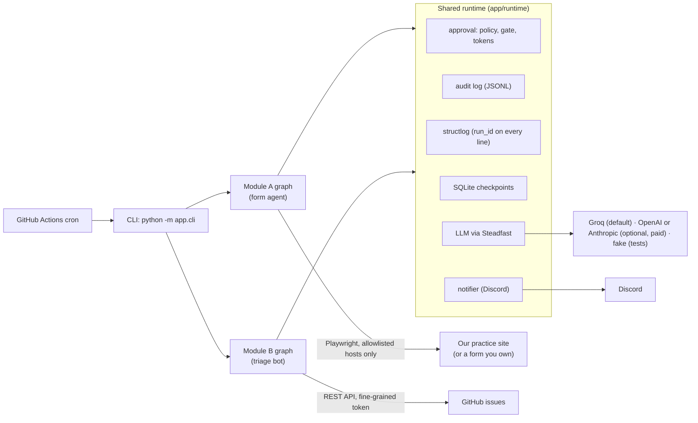
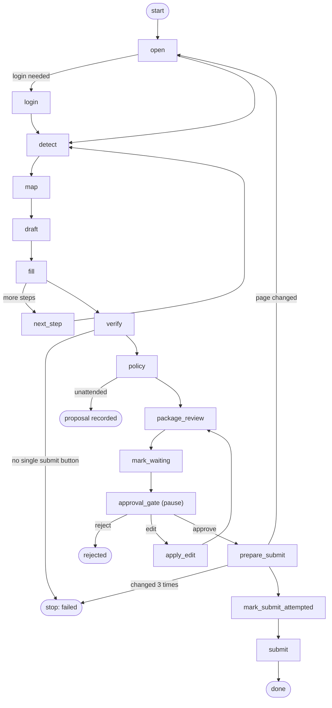
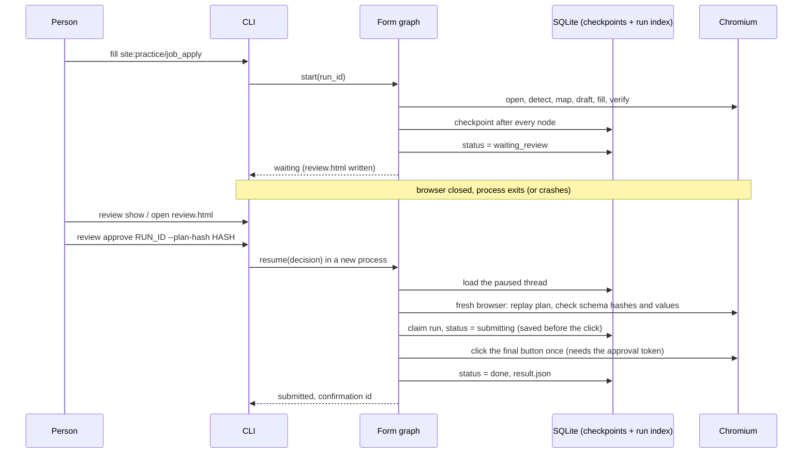
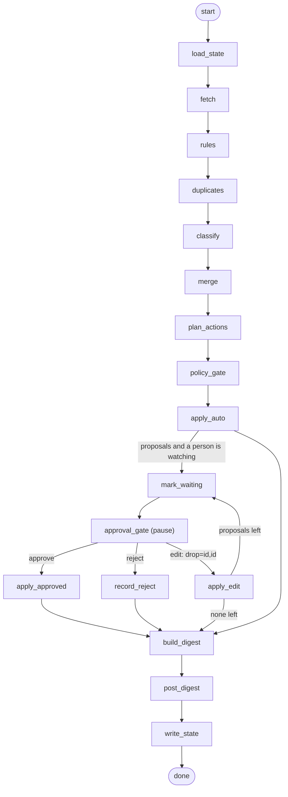
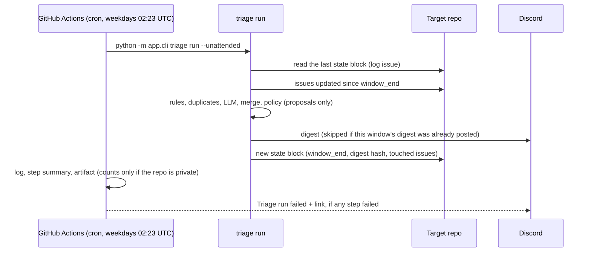

# askfirst: architecture

askfirst is two careful agents on one shared runtime:

- **Module A, the form agent.** It opens a web form in a real browser, fills what it can by rule
  from a profile, lets an LLM draft only the free-text answers, and then **stops**. A person
  reads a review page and approves, edits or rejects. Only an approval can make it click
  submit, and it clicks at most once, even if the process dies and restarts in between.
- **Module B, the triage bot.** On a schedule (GitHub Actions cron) it reads a repo's new and
  updated GitHub issues, sorts them with a written rubric (rules first, the LLM second), and
  posts a digest to Discord. Anything visible to people (comments, closing issues) is only ever
  proposed, never done by itself.

Both are LangGraph graphs that share the same approval, audit, logging, checkpoint and retry
code. The idea in one sentence: **the code, not a prompt, decides what the agent may do alone.**

This page explains how the pieces fit. What happens when things go wrong has its own page:
[failure-handling.md](failure-handling.md). The numbers behind accuracy claims are in
[results/evals.md](results/evals.md).

## 1. The pieces



| Part | What it does | Code |
|---|---|---|
| **CLI** | Every entry point: `fill`, `review list/show/approve/reject/edit`, `runs`, `audit`, `triage run`. It only parses arguments and prints; the work is in the modules. | `app/cli.py` |
| **Module A** | Detect fields, map them to the profile, draft free text, fill, verify, review, then replay and submit after approval. | `app/browser/` |
| **Module B** | Fetch issues, rules, duplicates, LLM classification, merge, plan actions, policy, digest, state. | `app/triage/` |
| **Shared runtime** | The approval layer, audit log, logging, checkpoints, run index, LLM wrapper, notifier, graph helpers. | `app/runtime/` |
| **Practice site** | Our own FastAPI forms (job application, contact, survey, a marketplace listing with login: three steps, then a review page). A test target, not part of the agent. | `practice_site/` |

## 2. The shared runtime

| Piece | What it gives both modules | Code |
|---|---|---|
| **Policy** | Each action kind has a registered risk: `read`, `reversible` or `irreversible`. The registered risk wins over whatever an action claims. Unknown kinds are blocked. | `app/runtime/approval.py` |
| **Approval gate** | A LangGraph node that pauses the graph with a review packet (`interrupt()`). It is pure: LangGraph re-runs it from the top on resume, so side effects live in the nodes around it. | `make_approval_gate` |
| **Approval token** | Proof that a person approved *this exact plan*. Only `issue_token()` can make one, only from an approve decision whose plan hash matches. It is HMAC-signed with a per-process secret and never stored. Every irreversible function calls `require_token()` first. | `issue_token`, `require_token` |
| **Checkpoints** | Every graph step is saved to `data/checkpoints.sqlite` (`durability="sync"`), so a crash loses at most the step that was running. One run = one LangGraph thread; the run ID is the thread ID. | `app/runtime/checkpoint.py`, `graphs.py` |
| **Run index** | One row per run with its status (`running`, `waiting_review`, `submitting`, `done`, `rejected`, `failed`, `needs_human_check`). | `app/runtime/runs.py` |
| **Audit log** | `data/runs/<run_id>/audit.jsonl`: one JSON line per event, append-only (open, write, flush, fsync), secrets masked. Actors are `agent:<node>`, `human:<name>` or `system`. | `app/runtime/audit.py` |
| **Logging** | structlog JSON (or `LOG_FORMAT=console`). Inside a run every line carries `run_id`, and Steadfast's lines get it as their `correlation_id`. Secrets are masked by key name, by shape (tokens, webhook URLs) and by exact value (every secret setting). | `app/runtime/logging.py` |
| **LLM** | One wrapper over Steadfast: `structured()` validates JSON against a Pydantic model plus our own validators, and feeds each problem back to the model for up to 3 attempts. Every call is audited (attempts, tokens). Prompts are versioned files. Providers: `groq` (default, free tier), `openai` or `anthropic` (optional, paid; install the extra), and `fake`, which answers offline. `LLM_FALLBACK` names a second provider to switch to when the main one fails. | `app/runtime/llm.py`, `app/prompts/` |
| **Notifier** | Discord webhooks with embeds, `allowed_mentions` off, 429 handling; a fake that only logs when no webhook is set. | `app/runtime/notify.py` |

### The policy table (risk x mode)

| Risk | Interactive (a person can answer) | Unattended (cron, nobody watching) |
|---|---|---|
| read | runs | runs |
| reversible, on the module's allow list | runs | runs |
| reversible, not on the allow list | waits for a person | proposal only (deferred) |
| irreversible | waits for a person | proposal only (deferred), never runs |
| unknown kind | blocked | blocked |

| Module | Action | Risk | Runs by itself? |
|---|---|---|---|
| A | fill a field, click "next" | reversible | yes (allow list) |
| A | save a draft | reversible | no |
| A | **submit the form** | irreversible | **never**: needs a token from a person's approval |
| B | add labels | reversible | only in `apply-labels` mode (`TRIAGE_MODE`) |
| B | "please add info" comment | irreversible (people see it) | never |
| B | close as duplicate or stale | irreversible | never |

## 3. Module A: the form agent



| Node | What it does | LLM? |
|---|---|---|
| `open`, `login` | Opens the target (only hosts in `ALLOWED_HOSTS`). Logs in with credentials from settings when the site profile says so; saved cookies skip it next time. | no |
| `detect` | Reads the page in Chromium: every field's label (label, aria-labelledby, fieldset legend...), kind, required flag, options and limits; buttons and which one is the final submit. Hidden fields and honeypots are marked not fillable. Each step gets a schema hash. | no |
| `map` | Matches fields to the profile by rule: data row > site override > autocomplete > synonyms > input type > canned answers. Passwords and anything unclear are left for a person. | no |
| `draft` | One call per step for the free-text questions only. Validators: exact keys, length limits, no placeholders, and a **fact check** (names, numbers, emails and URLs must be in the profile or on the page). A draft that still fails is left empty and flagged. | **yes, only here** |
| `fill` | Types each value and reads it back; retries a mismatch once, then flags it. | no |
| `verify`, `policy` | Re-reads every value, finds the single final button, asks the policy about `submit_form`. | no |
| `package_review`, `mark_waiting` | Writes `review.html` / `review.json` (values with their source, drafts, flags, screenshots, the plan hash), marks the run `waiting_review`, sends one "review waiting" ping. | no |
| `approval_gate` | Pauses. The browser is closed; the run can wait for days. | no |
| `prepare_submit` | Opens a **fresh** browser, replays the approved plan, checks each step's schema hash and every value. A changed page starts the fill again from `open` and goes back to the reviewer (after 2 such restarts the run stops). | no |
| `mark_submit_attempted`, `submit`, `confirm` | Claims the run (compare-and-set, so two approvals can't both click), saves "submitting" **before** the click, clicks once with the token, checks the success page. | no |

### Fill, pause, restart, approve, replay, submit



Three guards inside the browser keep it from doing anything else (`app/browser/session.py`):

1. **Host allowlist.** `goto()` refuses other hosts, and a route handler aborts every request
   (pages, scripts, images, XHR) to them. Each block is an audit event. Service workers are off
   and WebSockets are closed, since neither goes through that handler. Playwright doesn't route
   redirects, so page loads are fetched with redirects off and every hop is checked before the
   browser may follow it; a redirect to another host is blocked and audited.
2. **Network guard.** Every POST, PUT, PATCH and DELETE is aborted, so a stray Enter key can't
   submit. Exactly two writes are ever let through, one at a time: the login form's own POST,
   and the approved submit.
3. **Submit blocker.** A script that runs before the page's own cancels `submit` events and
   turns `form.submit()` into a no-op, unless the approved submit step switches it off.

## 4. Module B: the triage bot



| Node | What it does | LLM? |
|---|---|---|
| `load_state` | Reads the last state block from the "Triage log (bot)" issue: the window starts at the last `window_end` (7 days back the first time). Also reads whether the repo is private. | no |
| `fetch` | Issues updated in the window, plus every open issue (for duplicates and for issues that went stale). Pull requests and the bot's own log issue are dropped. | no |
| `rules` | The rubric's deterministic rules: security words -> `security`, P0, escalated; a bug report missing steps/expected/actual -> needs-info; no update for 30 days -> stale; already triaged and unchanged (or only changed by the bot) -> skipped. | no |
| `duplicates` | Older open issues with similar words (a candidate list the LLM may pick from, never outside it). | no |
| `classify` | Batches of 5 to the LLM. Validators: exact issue numbers, labels on the allowlist, duplicates from the candidate list, a rationale that quotes the issue, length limits. A failing batch is split; a failing issue is "unclassified". | **yes** |
| `merge` | One result per issue; **rules win** and every override is audited. | no |
| `plan_actions`, `policy_gate` | Labels, "please add info" comments, close proposals (never for escalated security issues). The shared policy decides each one. | no |
| `apply_auto` | Creates missing labels with the rubric's colours, then adds labels (only in `apply-labels` mode). Records the issues it touched. | no |
| `build_digest`, `post_digest` | Markdown, JSON and Discord embeds (split within Discord's limits, at most 4 messages). Posted once per window and digest hash. | no |
| `write_state` | Adds a comment to the log issue: a short summary plus a hidden `<!-- triage-state {...} -->` block. | no |

### The schedule



## 5. Files and data

| Where | What |
|---|---|
| `data/app.sqlite` | The run index (one `runs` table, stdlib `sqlite3`). |
| `data/checkpoints.sqlite` | LangGraph's checkpoints for every run (async SQLite saver, `busy_timeout` 10 s). |
| `data/runs/<run_id>/audit.jsonl` | The run's audit timeline. |
| `data/runs/<run_id>/review.html`, `review.json` | What the reviewer sees (form runs). |
| `data/runs/<run_id>/artifacts/*.png` | Step screenshots and the confirmation page. |
| `data/runs/<run_id>/result.json` | The submit result and confirmation id. |
| `data/runs/<run_id>/digest.md`, `digest.json` | The triage digest. |
| `data/storage/<site>.json` | Saved login cookies for a site (local only). |
| GitHub: "Triage log (bot)" issue | The triage bot's run-to-run state, one comment per run. |

Run IDs sort by time and say what they are: `form-20261103-0831-ab12`, `triage-...`.

An audit line looks like this:

```json
{"ts": "2026-11-08T03:00:01Z", "run_id": "form-20261108-0300-ab12", "actor": "human:boss",
 "action": "decision", "detail": {"choice": "approve", "plan_hash": "9f2c..."}, "outcome": "ok"}
```

## 6. Failure handling

Short version: a failure either leaves the decision to a person (a flagged field, an
unclassified issue, a proposal) or stops the run cleanly; it never guesses and never does an
irreversible action. Crashes lose at most one step. A failure after the submit click ends as
`needs_human_check`, never a second click: at once if the process survives, or via
`python -m app.cli runs continue <run_id>` if it was killed (until then the run shows
`submitting`). The full table, with the test behind each
row, is in [failure-handling.md](failure-handling.md).

## 7. Safety and ethics

- **Only our own forms.** The browser may load only hosts in `ALLOWED_HOSTS` (default
  `127.0.0.1,localhost`); the network guard aborts everything else. It is tested against our own
  practice site and fixtures written by hand, never against a site we don't own.
- **No evasion.** No CAPTCHA solving, no stealth plugins, no fingerprint spoofing, no proxies.
  The User-Agent is Chromium's own string with our name added, so sites can tell it apart:
  `Mozilla/5.0 (X11; Linux x86_64) AppleWebKit/537.36 (KHTML, like Gecko) askfirst/0.1.0
  (human-reviewed form automation)`.
- **Honeypots and hidden fields are never touched**, and hidden tokens are never changed
  (100% in the detection eval and in the browser tests).
- **Nothing irreversible without a person.** No bypass flag exists, not even for tests: tests go
  through the real approval path.
- **A fake persona.** Every profile, fixture, screenshot and the demo use Riya Testwell from
  `profiles/example.yaml`, who does not exist.
- **Secrets stay secret.** Passwords are typed by rule, never sent to the LLM, and masked in
  logs, the audit log, review files, errors and the checkpoint database (tested). The GitHub
  token is a fine-grained PAT with Issues read/write and Metadata read on the one target repo.
- **Where data goes.** Form drafting sends the LLM provider only the free-text questions, the
  page title and the profile's name, work, education and skills (no contact details, address or
  passwords). Triage sends each issue's title and body (also for private repos) to the LLM
  provider and puts titles and links in the Discord digest; only the public workflow outputs
  (log, step summary, artifact) are counts-only for a private repo.

## 8. Design decisions

- **Why review in the CLI and a static HTML page, not a web app?** One person reviews, on their
  own machine. A static `review.html` plus `review approve <run_id>` has no server to secure, and
  the same commands work for triage proposals. A web dashboard was out of scope on purpose.
- **Why replay instead of keeping the browser open?** A browser can't be saved in a checkpoint,
  and a review can take hours or outlive the process. So after approval the agent opens a fresh
  browser, refills from the approved plan and checks the page is still the page that was
  reviewed (schema hashes). That is what makes "approve after a restart" safe.
- **Why does the GitHub log issue hold the triage state?** The bot runs on GitHub Actions, which
  keeps no disk between runs. The repo it already has a token for is the simplest place that
  does, and a person can read the state there.
- **Why do rules beat the LLM on security?** A missed security report is the costliest mistake,
  and a keyword rule never has a bad day. The LLM can't lower a rule's category or priority, and
  every override is audited. The eval requires 100% security escalation recall.
- **Why is the LLM only allowed to write text?** Selectors, mapping, clicks and labels are all
  decided by code that can be tested. The LLM drafts answers and suggests triage labels, and
  every output is validated (with Steadfast's feedback loop) before it is used.
- **Why SQLite?** One machine, one person, a handful of runs a day. Two small files, no server,
  and LangGraph's SQLite checkpointer does the rest.

## 9. Known limits

- **Forms**: one profile per run; file uploads only from `profiles/files/`; no CAPTCHA, ever, so
  a form behind one can't be done. Very dynamic widgets beyond the ones in our fixtures (custom
  date pickers, drag and drop) may need a site override or a person.
- **Multi-step forms** can't resume mid-way after a crash: start a new run (nothing was sent).
- **Triage** knows one connector (GitHub issues) and one rubric. Duplicate detection is word
  similarity, not embeddings, so it misses duplicates worded very differently.
- **The fact checker is strict**: an answer that mentions something true but not in the profile
  is left empty for a person. That is the intended trade.
- **Eval samples are small** and our own (16 form pages, 30 issues); see
  [results/evals.md](results/evals.md) for what the numbers do and don't say.
- **GitHub cron** can run late or be skipped when GitHub is busy, and schedules turn off in
  public repos after 60 days without activity.
