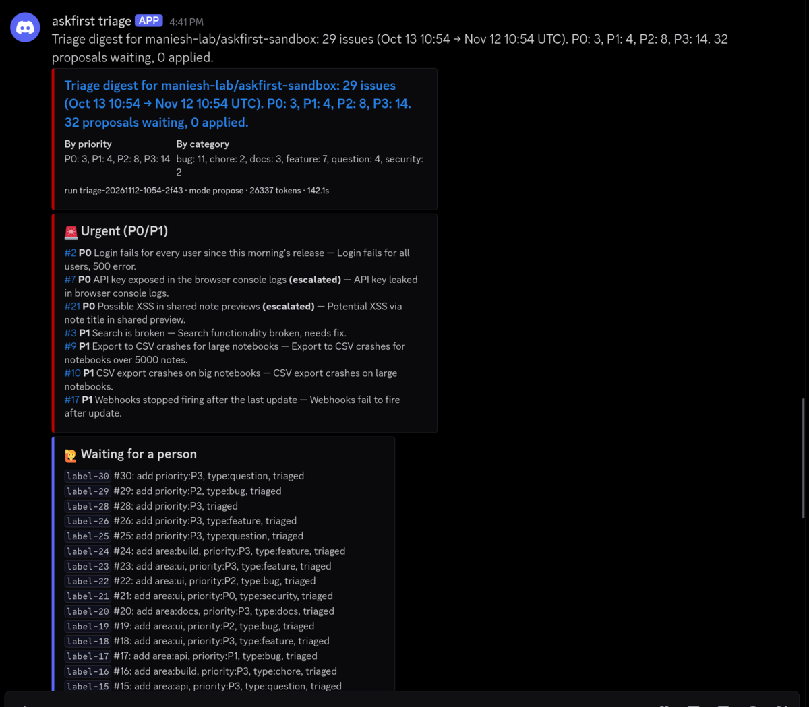

# First live triage run (digest in Discord)

**The claim**: the triage bot reads real GitHub issues, classifies them with a real model, posts
one structured digest to Discord, and changes nothing on GitHub unless it is allowed to.

**Run** on 2026-11-12, started by hand from GitHub Actions:
[run 43204377101](https://github.com/maniesh-lab/askfirst/actions/runs/43204377101)
(`gh workflow run triage.yml -f since=30d -f mode=propose`, commit `e653170`). Target:
`maniesh-lab/askfirst-sandbox`, a public repo we own whose 30 issues are fake test data.
Model: `openai/gpt-oss-20b` on Groq.

## What happened

| Step | Result |
|---|---|
| Check configuration | passed (secrets and `TRIAGE_REPO` set) |
| Fetch | 29 open issues in the window (Oct 13 to Nov 12); #27 skipped because it was already labelled `triaged` and unchanged since the last run |
| Classify | 6 Groq calls, 26,337 tokens, 142 s for the whole run |
| Rules | both security issues (#7, #21) escalated to a person; #3 and #14 flagged as missing details; #12 found as a duplicate of #11 |
| Plan | 32 proposals (labels, one "please add steps" comment, one duplicate close), **0 applied**: propose mode only lists them |
| Digest | posted to Discord (screenshot below), also in the run's step summary and artifact |
| GitHub writes | only the bot's own log issue (#31) got a comment with the run state; no issue was labelled, commented on or closed |

Not perfect: #10 is a duplicate of #9 and this run missed it (the live eval on the same issues
found both duplicates; see [evals.md](evals.md)). Missing a duplicate costs nothing here: it is
listed as a normal issue and a person still sees it.

## Screenshot (fake sandbox data)

The preview `docs/digest.png` (made by `scripts/make_demo.py` from a local run) shows the same
layout in full; this screenshot is the real message.
