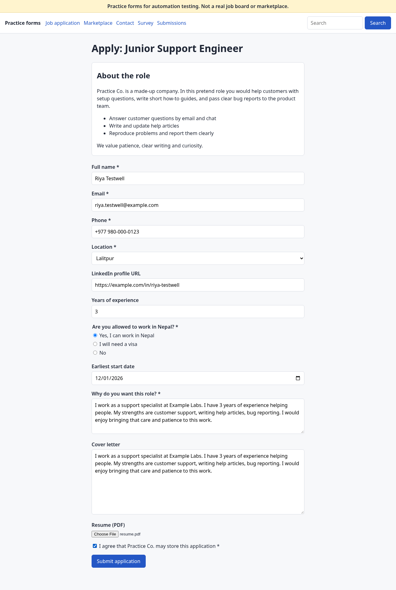
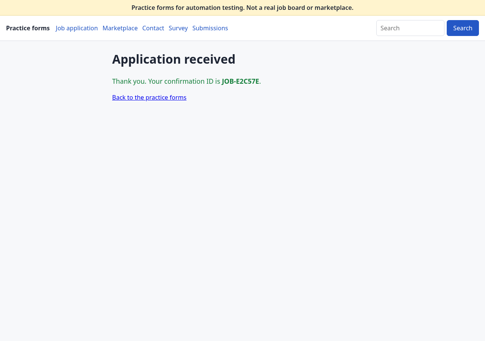

# Real form, end to end

**The claim**: the browser agent fills a real form end to end and pauses before submitting.
After approval, even after a restart, it submits exactly once.

**Proven** on 2026-11-08 with the code as of that day, on our practice site deployed on Render's free
plan at `https://askfirst-practice.onrender.com` (a public website we own; built from
`render.yaml`). The agent ran on a laptop (Arch Linux, headless Chromium) with
`ALLOWED_HOSTS=127.0.0.1,localhost,askfirst-practice.onrender.com`, the fake persona from
`profiles/example.yaml` and the fake LLM (`LLM_PROVIDER` empty).

Run ID: `form-20261108-1730-1f9e`.

## What happened

| Time (UTC) | Step | Evidence |
|---|---|---|
| 17:30:29 | `python -m app.cli fill site:practice/job_apply` opens the live job form | audit: `agent:open` |
| 17:30:31 | 12 fields filled (2 answers drafted, 1 flagged: the consent box), then it **stops**: `run form-20261108-1730-1f9e: waiting` | audit: `waiting_review`, plan hash `f3abbafb197d...`; screenshot below |
| before approval | The site's `/submissions` page shows **0** submissions | checked by hand |
| (restart) | The terminal is closed; approval happens in a new terminal and a new process, about 3.5 minutes later | |
| 17:33:56 | `python -m app.cli review approve form-20261108-1730-1f9e`: the decision (same plan hash) is recorded; a fresh browser replays the approved plan and checks the page is unchanged | audit: `human:<reviewer> decision approve`, `agent:prepare_submit` |
| 17:33:58 | The run is claimed for the click, then **Submit application** is clicked once | audit: `submit_attempted`, then `submitted` |
| 17:33:58 | Success page: `JOB-E2C57E`; run status `done` | `result.json`, screenshot below |
| after | `/submissions` shows **exactly 1** row: `JOB-E2C57E`, 17:33:58 UTC, bot flag empty | checked by hand |

## Screenshots (fake persona only)

The live form as the agent left it for review, before approval (nothing submitted yet):

The success page after approval:

## Notes

- The two free-text answers are identical because the offline fake LLM uses one template; with
  `LLM_PROVIDER=groq` a real model drafts each answer (they go through the same fact check).
- The free Render instance sleeps after 15 idle minutes; the site was opened in a browser first
  to wake it, since the agent's page timeout is 15 seconds.
- The same loop runs in CI on every push, in Docker with the practice site on a private
  network (`scripts/compose_smoke.sh`), and in `tests/browser/test_form_run.py`
  (`test_restart_while_waiting_then_approve_in_new_process`).
