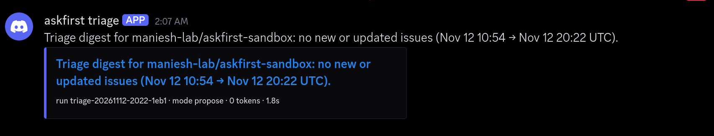

# Scheduled triage run

**The claim**: the triage bot runs on its own timer, with nobody starting it, and the run goes
green with the digest posted to Discord.

**Run**: [run 43299544507](https://github.com/maniesh-lab/askfirst/actions/runs/43299544507),
event `schedule` (started by GitHub's timer, not by hand), commit `dc9b997`. Target:
`maniesh-lab/askfirst-sandbox` (our own repo of fake test issues), model `openai/gpt-oss-20b` on
Groq, mode `propose`.

## Timing, honestly

The workflow's real timer is weekdays at 02:23 UTC. To get the proof the same day instead of
waiting for the next weekday, a one-off line was added for 12:37 UTC on 12 Nov (`dc9b997`) and
removed after it ran (`1888e32`). The run uses the same workflow, the same secrets and the same
code path as the weekday timer; only the time differs.

GitHub started it at **20:21 UTC, about 7.7 hours late**. GitHub delays scheduled runs when its
queue is busy (the 02:23 runs on 10 to 12 Nov also started 7.2 to 7.6 hours late). That is why the
digest is a morning summary, not a to-the-minute alert.

## What happened

| Step | Result |
|---|---|
| Check configuration | passed |
| Install + triage | green in 34 s for the whole job (the triage step itself took about 2 s) |
| Window | Nov 12 10:54 → 20:22 UTC, picked up from the end of the previous run (the manual one, [live-triage-run.md](live-triage-run.md)); no `since` was given |
| Issues | none new or updated in that window, so 0 Groq calls and 0 tokens |
| Digest | posted to Discord (1 message, screenshot below), also in the run's step summary and artifact |
| GitHub writes | only a new state comment on the bot's log issue (#31), saving the window for the next run |

An empty digest is the expected result: nothing changed in the sandbox between the two runs.
What this run proves is the unattended part: the timer fired, the secrets were read, the last
window was picked up and moved on, and a digest reached Discord without anyone touching it.

## Screenshot (fake sandbox data)

